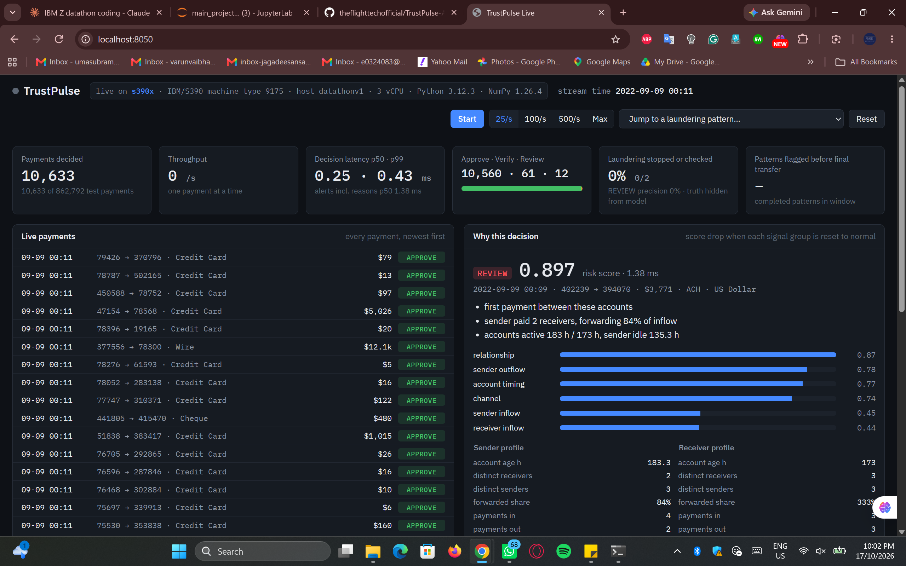

# TrustPulse AI

Real-time, network-aware risk scoring for instant payments, built and run on IBM LinuxONE (s390x).

IBM Z Datathon 2026, Theme 1: Real-Time AI for Critical Decisions.

## The problem

Instant-payment scams and money mules are hard to stop one transaction at a time. Each transfer on its own can look ordinary. The giveaway is how accounts behave together: money arrives in an account and leaves again within hours, one account collects from many new senders, a chain of first-time counterparties forms. By the time the last transfer lands, the money is gone.

TrustPulse scores every payment as it arrives, using what is already known about both accounts and their connections. Each payment gets one of three decisions, with a reason a bank analyst can read:

- **APPROVE**: let it through.
- **VERIFY**: add friction, such as confirmation of payee or step-up authentication.
- **REVIEW**: hold for an analyst.

## What runs on LinuxONE

Everything in this repository was developed and executed on an IBM LinuxONE Community Cloud VM (Ubuntu 24.04, s390x, 3 vCPU, 8 GB RAM). The Python stack uses Ubuntu's native s390x builds of NumPy, pandas, SciPy, scikit-learn and matplotlib. Measured on that VM:

| Step | Time on LinuxONE |
|---|---|
| Streaming feature build, 5.08M transactions | 13.5 s |
| Model training (sampled train set) | 29.8 s |
| Scoring, one transaction | 2.78 ms (sklearn per-call overhead) |
| Scoring, batched | 5.7 µs per transaction |
| Explaining 21,944 alerts | 2.3 s (about 105 µs per alert) |
| Live engine, one payment end to end (p50 / p99) | 0.256 ms / 0.395 ms |
| Live engine throughput, one payment at a time | 3,456 payments/s |
| Export of model and warm state (515k accounts, 979k pairs) | 2.5 s |

The live-engine rows come from `results/realtime_parity.json`: 20,000 test payments streamed one at a time, including reasons for every alert. The slowest single payment took 370 ms (a one-off pause; p99 is 0.4 ms). For comparison, scikit-learn's own `predict_proba` on one payment took 2.78 ms on the same VM, so the exported scorer is about 11× faster per payment.

### Telum II on-chip AI accelerator

The VM runs on an IBM z17 (machine type 9175, Telum II processor) under z/VM 7.3, and the guest sees the accelerator: `nnpa` appears in the CPU flags, and IBM's zDNN library (Ubuntu `libzdnn0` 1.0.1) reports NNPA installed. We tested it with IBM Snap ML 1.17.2, which runs tree-ensemble inference on the accelerator through zDNN (`tree_format="zdnn_tensors"`). A Snap ML boosting model (300 rounds, depth 8, same features and training sample) was scored both ways on the same test days (`scripts/telum_benchmark.py`, results in `results/telum_benchmark.json`):

| Snap ML inference | CPU (`compress_trees`) | Telum II NNPA (`zdnn_tensors`) |
|---|---|---|
| All 862,792 test payments | 1.48 s (582,579/s) | 9.91 s (87,042/s) |
| Batch of 10,000 | 18.0 ms | 93.5 ms |
| One payment | 0.020 ms | 0.045 ms |
| Test PR-AUC / recall at 0.5% alerts | 0.478 / 0.627 | 0.478 / 0.627 |

The accelerator path is real: with the zDNN library hidden (`SNAPML_ZDNN_LIB=/nonexistent`), Snap ML refuses `zdnn_tensors` with `zDNN library supported only in Z systems`. Scores and decisions were identical on both paths. For this model size on a 3-vCPU guest, though, the accelerator path was 2–7× slower than Snap ML's CPU path, so the live engine stays on the CPU. Snap ML's model was also less accurate than the scikit-learn model the engine uses (PR-AUC 0.478 vs 0.525). Larger models, larger batches, or a newer zDNN release may change this; the script makes the comparison repeatable.

## Approach

1. **Leakage-safe streaming features.** Every transaction becomes an outgoing event for the sender and an incoming event for the receiver. Running totals exclude the current event, so each row only sees strictly earlier activity: counts, amounts, distinct counterparties, pass-through ratio (money out vs money in), account age, time since last activity, and whether the pair has transacted before.
2. **Gradient-boosted model** (scikit-learn `HistGradientBoostingClassifier`) trained on a time split, with the alert threshold fixed on validation and then frozen for test.
3. **Decision layer.** Validation-set quantiles set REVIEW (top 0.5%) and VERIFY (top 2%) thresholds.
4. **Faithful reasons.** For each alert, each feature group is reset to its typical value, and the drop in score is measured. The top three groups become the reason text, so the explanation comes from the model itself, not from separate rules.

## Real-time engine and live console

The notebook proves the method in batch. `trustpulse/engine.py` runs it the way a bank would: one payment in, one decision out, before the money moves.

- **Streaming state.** A running profile per account (payments in and out, amounts, distinct counterparties, first and last activity) and a count per sender-receiver pair. Each payment reads the profiles, gets a decision, then updates them. Every feature is identical to the notebook's batch definition; `build.parity_check` streams the test days through the engine and compares feature by feature against the notebook frame and against scikit-learn's own scores. On LinuxONE, over 20,000 payments: largest relative feature difference 4.4e-14, decisions identical to the batch pipeline in 100% of cases (`results/realtime_parity.json`).
- **Portable model.** The 300 trained trees are exported to flat arrays (`models/model_trees.json`). The engine walks all trees together with a few NumPy operations, so serving needs Python and NumPy only: no pandas, no scikit-learn, no compiler. That matters on s390x, where pip has no wheels for most of the data-science stack.
- **Decisions with reasons.** Thresholds come from the validation days (`models/engine_config.json`). For VERIFY and REVIEW, the engine re-scores the payment with each signal group reset to its typical value and reports the groups that moved the score most, in plain language.


*The live console on the LinuxONE VM: header shows s390x, machine type 9175 (IBM z17) and the host; a REVIEW alert with its reasons and the score drop per signal group.*

- **Live console** (`app/server.py`, Flask). Replays the held-out test days through the engine in arrival order, at a chosen speed, and shows decisions, latency, throughput, alerts with reasons, and how early each laundering pattern was flagged (ground truth is shown as an overlay and never reaches the engine). The same process exposes `POST /api/score` for single payments.

```bash
curl -s localhost:8050/api/score -H 'Content-Type: application/json' \
     -d '{"src": 1057, "dst": 653, "amount": 942, "currency": "US Dollar", "format": "ACH"}'
```

## Data

- **IBM Transactions for Anti-Money Laundering, HI-Small** (main evaluation): 5,078,345 transactions, 515,088 accounts, with laundering-pattern labels (fan-in, fan-out, cycle, scatter-gather, and others). Rows after 2022-09-10 are dropped: they are almost entirely pattern tails (over 60% laundering), not real traffic.
- **PaySim** (per-transaction baseline): 6.36M mobile-money transactions. Balance columns are excluded because PaySim cancels fraudulent transactions, so balances leak the label. PaySim senders are 99.85% unique, so it carries no network signal.

Split for IBM AML: train 1–6 Sep, validation 7–8 Sep, test 9–10 Sep 2022. Laundering rate is about 0.1% in all three.

## Results (IBM AML HI-Small, test set)

**Network features are the main driver.** Same model, same alert budget (about 0.6% of transactions flagged):

| Features | PR-AUC | ROC-AUC | Recall | Precision |
|---|---|---|---|---|
| Transaction only (amount, channel, currency, hour) | 0.064 | 0.910 | 0.354 | 0.073 |
| Transaction + network | **0.525** | **0.958** | **0.719** | **0.129** |
| Network, without channel and currency | 0.469 | – | 0.714 | 0.056 |

For comparison with published work, the best F1 on the laundering class over the test days is **0.54** (precision 0.69, recall 0.44). That is an upper bound, because the threshold is chosen on test. Egressy et al. (AAAI 2024) report 0.57–0.68 for offline graph neural networks and about 0.63 for gradient boosting with graph features on HI-Small, using a 60/20/20 temporal split. TrustPulse is in that range with simpler one-hop features that can be updated payment by payment.

The last row checks for a dataset artifact: about 87% of laundering in HI-Small uses ACH. With channel and currency removed, recall holds and PR-AUC stays near 0.47. The network signal is real; channel mainly adds precision.

**Decision bands:**

| Decision | Transactions | Laundering | Rate |
|---|---|---|---|
| APPROVE | 840,848 | 198 | 0.02% |
| VERIFY | 16,609 | 71 | 0.43% |
| REVIEW | 5,335 | 687 | 12.9% |

REVIEW plus VERIFY capture 79% of laundering transactions while touching 2.5% of traffic.

**Lead time.** Of 79 laundering patterns that start inside the test window, 96% raise at least one alert, and 58% are flagged before their final transfer (median: one transaction, 4.7 hours early). Patterns that continue past 10 Sep are cut off, so these lead times are a lower bound.

**Hard negatives.** 4,037 high-volume receiving accounts with no laundering involvement in training (merchant and payroll analogues). Their false-alert rate is 0.60%, against 0.54% for all legitimate traffic, so busy legitimate accounts are not over-flagged.

**PaySim baseline** (per-transaction only): test PR-AUC 0.559, ROC-AUC 0.966. PaySim's fraud rate jumps from 0.08% in training to 1.09% in the late test steps as legitimate volume collapses, so its precision figures are inflated and are not used for claims.

### What did not work

Risk propagation was tested: a flagged transaction leaves decaying risk on both accounts, and later payments touching them inherit it. Fourteen settings (attenuation 0.2–0.95, half-life 6–48 h, two seeding thresholds) were compared on validation. None beat the plain network model, so propagation is switched off. The structural network features already carry the linked-account signal, and propagation mostly added false alerts.

## Repository layout

```
notebooks/main_project.ipynb   end-to-end notebook (PaySim baseline, IBM AML engine, evaluation, export)
trustpulse/engine.py           real-time engine: streaming state, tree scorer, decisions, reasons (NumPy only)
trustpulse/build.py            notebook helpers: export to the engine, parity and latency check
app/server.py, app/static/     live console and REST scoring endpoint (Flask)
models/                        exported trees and engine configuration
tests/                         streaming-vs-batch parity tests; synthetic bundle for a data-free demo
figures/                       ablation, lead time, decision bands, example pattern
scripts/telum_benchmark.py     Snap ML inference on CPU vs the Telum II accelerator (NNPA via zDNN)
results/                       metrics.json (evaluation), realtime_parity.json (engine), telum_benchmark.json (accelerator)
resources.md                   libraries, datasets and tools, with licenses
```

Raw data and model artifacts are not committed. They are downloaded and regenerated on the VM.

## How to run on LinuxONE

```bash
sudo apt update
sudo apt install -y python3-venv python3-dev build-essential tmux \
    python3-numpy python3-pandas python3-scipy python3-sklearn python3-matplotlib
python3 -m venv --system-site-packages ~/tp
source ~/tp/bin/activate
pip install jupyterlab kaggle

git clone https://github.com/theflighttechofficial/TrustPulse-AI.git ~/trustpulse
mkdir -p ~/trustpulse/data && cd ~/trustpulse/data
kaggle datasets download -d ealaxi/paysim1 --unzip
kaggle datasets download -d ealtman2019/ibm-transactions-for-anti-money-laundering-aml -f HI-Small_Trans.csv
kaggle datasets download -d ealtman2019/ibm-transactions-for-anti-money-laundering-aml -f HI-Small_Patterns.txt
unzip -o '*.zip'

cd ~ && jupyter lab --no-browser --ip=127.0.0.1 --port=8888
```

From your own machine, open a tunnel and browse to `http://localhost:8888`:

```bash
ssh -i <key> -L 8888:localhost:8888 linux1@<vm-ip>
```

Open `notebooks/main_project.ipynb` and run all cells. On an 8 GB VM, add 4 GB of swap first; the feature build peaks at about 3 GB.

Then start the live console (run `Part 3` of the notebook first; it writes `models/` and `artifacts/engine/`):

```bash
pip install flask            # or: sudo apt install python3-flask
cd ~/trustpulse && python app/server.py
```

Tunnel port 8050 the same way (`ssh -i <key> -L 8888:localhost:8888 -L 8050:localhost:8050 linux1@<vm-ip>`) and open `http://localhost:8050`.

To try the console without the dataset: `python tests/make_synthetic_bundle.py /tmp/tp_demo` then `python app/server.py --model-dir /tmp/tp_demo/models --artifacts /tmp/tp_demo/engine`. Tests: `python -m pytest -q tests`.

Pip has no s390x wheels for SciPy or scikit-learn, and building them from source needs a Fortran compiler and takes a long time. Ubuntu's packages avoid that.

## Limitations

- Both datasets are synthetic. Results show the method works on realistic simulated behaviour, not on a bank's live traffic.
- Lead time is measured on a two-day test window, so long patterns are truncated.
- The model leans on payment channel for precision; the robustness check above quantifies this.

## References

- E. Altman et al., "Realistic Synthetic Financial Transactions for Anti-Money Laundering Models", NeurIPS 2023 Datasets and Benchmarks.
- B. Egressy et al., "Provably Powerful Graph Neural Networks for Directed Multigraphs", AAAI 2024 (arXiv:2306.11586).
- E. A. Lopez-Rojas, A. Elmir, S. Axelsson, "PaySim: A financial mobile money simulator for fraud detection", EMSS 2016.
